# ETHNOTRACE: COMPLETE TECHNICAL AUDIT & GAP ANALYSIS REPORT
**Hackathon Target:** EthnoHack 2026 — Track 1: Traditional Knowledge Mining  
**Audit Role:** Principal Software Architect, Senior Full-Stack Engineer, AI/ML Engineer, Data Engineer, Security Auditor, Hackathon Technical Evaluator  
**Audit Date:** November 2026  
**Audited Directory:** `D:\ethnotrace`  
**Application Runtime:** FastAPI (Python 3.13) + React / Vite / TypeScript + SQLite / In-Memory Graph  

---

## SECTION A: EXECUTIVE SUMMARY

### 1. High-Level Status Assessment
EthnoTrace was envisioned as a production-grade, autonomous, AI-driven ethnobotanical research intelligence platform capable of transforming unstructured historical and indigenous medicinal manuscripts into an ambiguity-aware, scientifically grounded, and geographically anchored knowledge graph.

The current implementation is an **end-to-end working proof-of-concept (POC) prototype**, featuring a polished React/TypeScript single-page dashboard and a clean, responsive FastAPI backend. The frontend renders real visual components (knowledge graph canvas, interactive Leaflet world map, multi-tab document ingestion, analytical charts, evidence cards, and research copilot chat interface). The system starts cleanly, passes 10 unit tests, and serves a live REST API alongside static assets.

However, a **rigorous source code and runtime inspection reveals that beneath the polished UI, the cognitive core of the system is heavily rule-based, dictionary-bound, or hardcoded**:
- The **Multilingual NLP engine** is not a transformer or multilingual NER pipeline; it is a hardcoded Python dictionary of 10 Indian medicinal plants mapped to static regex lists for plant parts, preparations, and ailments.
- The **Botanical Entity Resolution engine** does not connect to live botanical taxonomic backbones (Kew POWO, MPNS, GBIF, WFO, IPNI); it resolves against a static 10-species Python array and hardcodes three ambiguous vernacular names (*Brahmi*, *Shankhpushpi*, *Sarpagandha*).
- The **Research Copilot** does not invoke a Large Language Model (Gemini/OpenAI/Anthropic/Local LLM) or a persistent Qdrant vector database; it matches input queries using raw Python string conditionals (`if "ambiguous" in lower_q: ...`) and in-memory BM25 keyword matching.
- The **Scientific Evidence Classifier** assigns evidence tiers (Tier 1 to 4) using keyword regex rather than biomedical NLI models, and does not dynamically query the PubMed Entrez API.
- The **Multi-Agent Orchestrator** contains no LangGraph state graphs or LangChain agents; it is a single Python class executing sequential linear methods.
- The **Published Benchmark Results** (`benchmark_eval.py`) evaluate the system on synthetic sentences containing the exact 10 plants hardcoded in the dictionary (100% data leakage), and several metrics (such as Relation Extraction F1 of 0.895 and Faithfulness of 0.985) are literally hardcoded floating-point values in a dictionary.

### 2. Quantitative Requirement Audit Breakdown

| Implementation Status | Count of Requirements | Percentage of Total |
| :--- | :--- | :--- |
| **Fully Implemented** | **31** | **17.2%** |
| **Partially Implemented** | **58** | **32.2%** |
| **Mocked / Hardcoded / Rule-Stubbed** | **64** | **35.6%** |
| **Completely Missing** | **27** | **15.0%** |
| **Unverified** | **0** | **0.0%** |
| **TOTAL AUDITED REQUIREMENTS** | **180** | **100.0%** |

### 3. Readiness Ratings

| Dimension | Readiness Rating | Production Feasibility |
| :--- | :--- | :--- |
| **Hackathon Presentation / Demo Readiness** | **82%** | High for scripted presentations; UI is visually compelling, mock data is scientifically plausible, and end-to-end flows run without crashing. |
| **Scientific / Academic Integrity** | **24%** | Low; lacks real taxonomic verification APIs, relies on static regex dictionaries, and exhibits synthetic test circularity. |
| **Production Enterprise Readiness** | **18%** | Very Low; insecure SHA-256 single-round passwords, no JWT token expiration, in-memory graph by default, missing RBAC route middleware. |
| **Autonomous AI / Multi-Agent Readiness** | **12%** | Minimal; no genuine autonomous agents, no dynamic tool-calling LLMs, no self-healing workflows, no LangGraph. |

---

## SECTION B: DETAILED REQUIREMENT COMPLIANCE MATRIX

Each requirement from the project specification has been audited against the physical code in `D:\ethnotrace`.

### Module 1: EthnoDocument Intelligence (27 Requirements)

| # | Requirement | Status | Concrete Code Evidence & Missing Work | Priority |
| :--- | :--- | :--- | :--- | :--- |
| 1.1 | PDF format upload & processing | **FULLY IMPLEMENTED** | `backend/api/documents.py`: `fitz.open(stream=contents, filetype='pdf')` extracts text and page numbers via PyMuPDF. | P0 |
| 1.2 | TXT format upload & processing | **FULLY IMPLEMENTED** | Handled natively via utf-8 string decoding in `documents.py`. | P1 |
| 1.3 | DOCX format upload & processing | **FULLY IMPLEMENTED** | Handled via `docx.Document(io.BytesIO(contents))` in `documents.py`. | P1 |
| 1.4 | CSV format upload & processing | **PARTIALLY IMPLEMENTED** | CSV is accepted by file extension validation, but rows are concatenated into raw text rather than structured tabular mapping. | P2 |
| 1.5 | JSON format upload & processing | **PARTIALLY IMPLEMENTED** | JSON accepted, parsed as generic string, lacks schema validation against ethnobotanical exchange schemas. | P2 |
| 1.6 | Drag-and-drop document upload UI | **FULLY IMPLEMENTED** | `frontend/src/pages/DocumentIntelligence.tsx`: HTML5 drag-and-drop handlers implemented with dropzones. | P0 |
| 1.7 | Multiple document upload | **FULLY IMPLEMENTED** | Batch upload supported in UI and handled concurrently via `documents.py`. | P1 |
| 1.8 | Document metadata extraction | **PARTIALLY IMPLEMENTED** | Title, author, page count, and file size extracted; publication year and DOI extraction missing. | P1 |
| 1.9 | PDF text extraction | **FULLY IMPLEMENTED** | PyMuPDF page-by-page extraction loop in `documents.py` lines 78-88. | P0 |
| 1.10 | OCR for scanned documents | **MOCKED / HARDCODED** | `documents.py` line 92 explicitly sets `ocr_performed: False`. No PaddleOCR or Tesseract bindings exist. | P1 |
| 1.11 | Table extraction from documents | **NOT IMPLEMENTED** | No `pdfplumber`, `camelot`, or vision-table extractor present; tables are dumped as jumbled raw text. | P2 |
| 1.12 | Page-level source preservation | **FULLY IMPLEMENTED** | `DocumentPage` DB model records `page_number`, `raw_text`, and foreign key `document_id`. | P0 |
| 1.13 | Paragraph segmentation | **FULLY IMPLEMENTED** | Segmented via `raw_text.split('\n\n')` with paragraph indexing in `DocumentParagraph`. | P1 |
| 1.14 | Sentence segmentation | **PARTIALLY IMPLEMENTED** | Basic regex splitting on periods; lacks language-aware punctuation handling (e.g. Sanskrit danda `।`, Hindi purna viram). | P2 |
| 1.15 | Source text citation linking | **PARTIALLY IMPLEMENTED** | Backend stores `document_id` and `page_number`; frontend does not display exact bounding-box highlights on original PDFs. | P1 |
| 1.16 | Exact character offset preservation | **NOT IMPLEMENTED** | `PlantMention` model stores `context_snippet` but completely lacks `start_char` and `end_char` fields. | P1 |
| 1.17 | Document type classification | **PARTIALLY IMPLEMENTED** | Heuristic keyword classifier assigns 'Historical Text', 'Ethnobotanical Study', or 'Research Paper'. | P2 |
| 1.18 | Processing pipeline status tracking | **FULLY IMPLEMENTED** | Statuses `queued`, `processing`, `completed`, `failed` logged in DB and visible via polling. | P1 |
| 1.19 | Asynchronous task queue | **PARTIALLY IMPLEMENTED** | Uses FastAPI in-process `BackgroundTasks`; lacks robust Celery/Redis queue for high workloads. | P2 |
| 1.20 | Duplicate document detection | **PARTIALLY IMPLEMENTED** | Checks filename and size; lacks cryptographic content hashing (SHA-256) on raw binary streams. | P2 |
| 1.21 | Language identification on ingest | **PARTIALLY IMPLEMENTED** | Basic script range inspection detects Devanagari/Tamil; lacks `fasttext` or `langdetect` model. | P2 |
| 1.22 | Multi-column PDF layout handling | **NOT IMPLEMENTED** | Extracts raw text sequentially; two-column papers suffer from interleaved sentence reading order. | P1 |
| 1.23 | Footnote & reference stripping | **NOT IMPLEMENTED** | References and bibliography sections are ingested as regular text, generating spurious plant mentions. | P2 |
| 1.24 | Document deletion & cascade | **FULLY IMPLEMENTED** | `DELETE /api/v1/documents/{id}` deletes document, pages, paragraphs, and associated mentions. | P1 |
| 1.25 | Search within uploaded documents | **FULLY IMPLEMENTED** | SQLite `LIKE` and in-memory BM25 search over extracted text. | P1 |
| 1.26 | Export extracted document text | **PARTIALLY IMPLEMENTED** | JSON export available via API; markdown and formatted text exports missing. | P2 |
| 1.27 | Upload size limit enforcement | **FULLY IMPLEMENTED** | Enforces 50MB ceiling in file validation middleware. | P2 |

---

### Module 2: Multilingual Ethnobotanical NLP (25 Requirements)

| # | Requirement | Status | Concrete Code Evidence & Missing Work | Priority |
| :--- | :--- | :--- | :--- | :--- |
| 2.1 | Vernacular plant name extraction | **MOCKED / HARDCODED** | `backend/ml/nlp_engine.py`: Matches against static `MULTILINGUAL_DICTIONARY` containing only 10 plants. | P0 |
| 2.2 | Scientific botanical binomial NER | **PARTIALLY IMPLEMENTED** | Uses regex pattern `r'\b([A-Z][a-z]+ [a-z]+(?: var\. [a-z]+)?)\b'`. Catches valid names but also non-botanical Latin phrases. | P0 |
| 2.3 | Hindi Devanagari script NER | **MOCKED / HARDCODED** | Matches 10 fixed strings (नीम, अश्वगंधा, ब्राह्मी, तुलसी, etc.) in `nlp_engine.py`. | P0 |
| 2.4 | Tamil script NER | **MOCKED / HARDCODED** | Matches 10 fixed strings (வேம்பு, அமுக்கிரா, வல்லாரை, etc.) in `nlp_engine.py`. | P0 |
| 2.5 | Sanskrit transliteration NER (IAST) | **MOCKED / HARDCODED** | Fixed dictionary lookup for *Nimba*, *Aśvagandhā*, *Brāhmī*, *Tulasī*. | P1 |
| 2.6 | Plant part extraction | **MOCKED / HARDCODED** | Static wordlist regex (`leaf`, `leaves`, `root`, `bark`, `seed`, `flower`, `patra`, `mula`, `twak`). | P1 |
| 2.7 | Preparation method extraction | **MOCKED / HARDCODED** | Static wordlist regex (`decoction`, `paste`, `powder`, `infusion`, `swarasa`, `kashaya`, `churna`). | P1 |
| 2.8 | Administration route extraction | **MOCKED / HARDCODED** | Static keyword regex (`oral`, `topical`, `nasal`, `external`). | P2 |
| 2.9 | Traditional ailment extraction | **MOCKED / HARDCODED** | Static keyword list (`fever`, `cough`, `skin disease`, `wound`, `jvara`, `kasa`, `kushta`). | P0 |
| 2.10 | Dosage / Posology extraction | **PARTIALLY IMPLEMENTED** | Regex parses basic numeric quantities (`5-10 ml`, `2-4 g`, `ratti`, `pala`). | P2 |
| 2.11 | Contraindication extraction | **MOCKED / HARDCODED** | Keyword presence check for `avoid during`, `do not use in pregnancy`. | P2 |
| 2.12 | Traditional community attribution | **MOCKED / HARDCODED** | Regex matches hardcoded tribal/indigenous community names (*Irula*, *Santhal*, *Bhil*, *Gond*). | P1 |
| 2.13 | Geographical origin attribution | **MOCKED / HARDCODED** | Static list of Indian states/districts (*Western Ghats*, *Tamil Nadu*, *Kerala*). | P1 |
| 2.14 | Transliteration normalization | **NOT IMPLEMENTED** | No dynamic phonological transliterator (e.g. Indic-Trans or Polyglot); depends on literal string hits. | P1 |
| 2.15 | Entity confidence scoring | **MOCKED / HARDCODED** | Calculates arbitrary pseudo-confidence: 0.95 for scientific binomials, 0.90 for dictionary hits, 0.70 for partials. | P1 |
| 2.16 | Contextual snippet extraction | **FULLY IMPLEMENTED** | Extracts +/- 100 characters around the matched keyword in source paragraph. | P1 |
| 2.17 | Co-reference resolution | **NOT IMPLEMENTED** | Pronouns ("this shrub", "the aforementioned plant") are ignored; co-reference chains not resolved. | P2 |
| 2.18 | Zero-shot open-domain plant NER | **NOT IMPLEMENTED** | Unknown medicinal plants not in the 10-word dictionary are completely missed. | P0 |
| 2.19 | Multilingual tokenization | **PARTIALLY IMPLEMENTED** | Standard regex whitespace splitting; lacks sentencepiece or Indic-BERT subword tokenization. | P1 |
| 2.20 | Dependency relation extraction | **MOCKED / HARDCODED** | Uses proximity heuristics (`plant` within 15 words of `ailment`) instead of syntactic dependency trees. | P1 |
| 2.21 | Negation detection | **PARTIALLY IMPLEMENTED** | Checks for `not effective`, `ineffective`, `contraindicated` within 5-word window. | P2 |
| 2.22 | Active compound extraction | **MOCKED / HARDCODED** | Static list of 15 phytochemicals (*azadirachtin*, *withaferin A*, *bacoside A*, *curcumin*). | P1 |
| 2.23 | Pharmacological activity tagging | **MOCKED / HARDCODED** | Maps keywords to MeSH terms (*anti-inflammatory*, *antidiabetic*, *hepatoprotective*). | P1 |
| 2.24 | Batch NLP text pipeline | **FULLY IMPLEMENTED** | Batch execution loop runs sequentially over document paragraphs. | P1 |
| 2.25 | NLP export to JSON-LD | **PARTIALLY IMPLEMENTED** | Serializes to standard JSON; JSON-LD `@context` and vocabulary schemas missing. | P2 |

---

### Module 3: Botanical Entity Resolution & Taxonomic Verification (27 Requirements)

| # | Requirement | Status | Concrete Code Evidence & Missing Work | Priority |
| :--- | :--- | :--- | :--- | :--- |
| 3.1 | Vernacular name to species resolution | **MOCKED / HARDCODED** | Resolves only names in `MULTILINGUAL_DICTIONARY` to 10 hardcoded botanical records. | P0 |
| 3.2 | Homonym & ambiguity detection | **FULLY IMPLEMENTED** | Identifies ambiguous names (*Brahmi* -> *Bacopa monnieri* vs *Centella asiatica*). | P0 |
| 3.3 | Disambiguation candidate ranking | **PARTIALLY IMPLEMENTED** | Heuristic ranking based on region and co-occurring terms; lacks probabilistic Bayesian classifier. | P1 |
| 3.4 | Ambiguity status flag | **FULLY IMPLEMENTED** | Sets `is_ambiguous: True` and populates `candidate_species` array. | P0 |
| 3.5 | Kew Plants of the World Online (POWO) API | **NOT IMPLEMENTED** | No HTTP client calls to POWO API (`powo.science.kew.org`); taxonomy is entirely local. | P0 |
| 3.6 | Kew MPNS (Medicinal Plant Names Services) | **NOT IMPLEMENTED** | No integration with MPNS API or data dumps. | P0 |
| 3.7 | GBIF Backbone Taxonomy integration | **NOT IMPLEMENTED** | No queries to `api.gbif.org/v1/species`. | P1 |
| 3.8 | World Flora Online (WFO) integration | **NOT IMPLEMENTED** | No queries to WFO Plant List or API. | P2 |
| 3.9 | IPNI (International Plant Names Index) | **NOT IMPLEMENTED** | No IPNI registration lookup. | P2 |
| 3.10 | Taxonomic rank identification | **FULLY IMPLEMENTED** | Correctly stores `genus`, `species`, `family` in `BotanicalEntity` table. | P1 |
| 3.11 | Taxonomic status classification | **PARTIALLY IMPLEMENTED** | Distinguishes `accepted` vs `synonym` in hardcoded backbone; cannot verify unseeded species. | P1 |
| 3.12 | Botanical synonym resolution | **PARTIALLY IMPLEMENTED** | Maps hardcoded synonyms (e.g. *Melia azadirachta* -> *Azadirachta indica*). | P1 |
| 3.13 | Botanical authority formatting | **PARTIALLY IMPLEMENTED** | Authority strings (e.g. "(L.) A.Juss.") stored as static strings; lacks taxon author parser. | P2 |
| 3.14 | Plant family classification | **FULLY IMPLEMENTED** | Stores APG IV families (Meliaceae, Solanaceae, Plantaginaceae, etc.). | P1 |
| 3.15 | Taxonomic confidence score | **MOCKED / HARDCODED** | Produces static confidence numbers (1.0 for exact Latin match, 0.7 for ambiguous vernacular). | P1 |
| 3.16 | Disambiguation workflow UI | **FULLY IMPLEMENTED** | `frontend/src/pages/EntityResolution.tsx`: Displays ambiguity badges, candidate split cards, and resolution buttons. | P0 |
| 3.17 | Manual taxonomic override | **PARTIALLY IMPLEMENTED** | UI sends override request; backend updates mention status but does not retrain resolution weights. | P1 |
| 3.18 | Fuzzy string matching for misspellings | **PARTIALLY IMPLEMENTED** | Uses Python `difflib.SequenceMatcher`; lacks Levenshtein automaton or phonetic Metaphone indexing. | P1 |
| 3.19 | Vernacular polysemy detection | **FULLY IMPLEMENTED** | Correctly flags single vernacular token mapping to multiple distinct families. | P0 |
| 3.20 | Regional context weighting | **PARTIALLY IMPLEMENTED** | Checks if document mentions "Kerala" to prefer *Centella asiatica* over *Bacopa monnieri* for Brahmi. | P1 |
| 3.21 | Basionym tracking | **NOT IMPLEMENTED** | Historical botanical basionyms are not tracked in database schema. | P2 |
| 3.22 | Taxonomic resolution caching | **PARTIALLY IMPLEMENTED** | In-memory Python dictionary cache; lacks Redis persistent cache. | P2 |
| 3.23 | Export resolution report | **PARTIALLY IMPLEMENTED** | Generates JSON dump; lacks publication-ready CSV/Excel taxonomic audit sheet. | P2 |
| 3.24 | Unresolved plant queue | **FULLY IMPLEMENTED** | Unrecognized plant mentions routed to pending review queue in database. | P1 |
| 3.25 | Botanical identity audit trail | **PARTIALLY IMPLEMENTED** | Logs resolving agent/user to `ReviewRecord`; lacks change-history timeline for taxa. | P2 |
| 3.26 | Infraspecific taxon resolution | **NOT IMPLEMENTED** | Subspecies, varieties, and formas are truncated to binomial species. | P2 |
| 3.27 | Conservation status linking | **MOCKED / HARDCODED** | IUCN status (e.g. "Least Concern", "Vulnerable") is hardcoded in the 10-species seed array. | P2 |

---

### Module 4: Ambiguity-Aware Ethnobotanical Knowledge Graph (32 Requirements)

| # | Requirement | Status | Concrete Code Evidence & Missing Work | Priority |
| :--- | :--- | :--- | :--- | :--- |
| 4.1 | Dual-layer architecture (Traditional vs Scientific) | **FULLY IMPLEMENTED** | Graph node and edge schemas explicitly separate `TraditionalKnowledge` from `ScientificEvidence`. | P0 |
| 4.2 | Botanical taxon nodes | **FULLY IMPLEMENTED** | `BotanicalEntity` nodes represent accepted biological species. | P0 |
| 4.3 | Vernacular name nodes | **FULLY IMPLEMENTED** | `VernacularName` nodes model linguistic forms connected via `REFERS_TO`. | P0 |
| 4.4 | Traditional use nodes | **FULLY IMPLEMENTED** | `TraditionalUse` nodes capture ailments, body systems, and preparations. | P0 |
| 4.5 | Plant part nodes | **FULLY IMPLEMENTED** | Modeled as discrete nodes (`Leaf`, `Root`, `Bark`, `Seed`). | P1 |
| 4.6 | Preparation form nodes | **FULLY IMPLEMENTED** | Modeled as discrete nodes (`Decoction`, `Paste`, `Oil`). | P1 |
| 4.7 | Bioactive compound nodes | **FULLY IMPLEMENTED** | Phytochemical nodes (*Curcumin*, *Withaferin A*) linked via `CONTAINS_COMPOUND`. | P1 |
| 4.8 | Pharmacological target / activity nodes | **FULLY IMPLEMENTED** | Activity nodes (*Anti-inflammatory*, *Hepatoprotective*) linked via `EXHIBITS_ACTIVITY`. | P1 |
| 4.9 | Scientific publication nodes | **FULLY IMPLEMENTED** | Publication nodes store PMID, DOI, title, and journal. | P0 |
| 4.10 | Traditional community nodes | **FULLY IMPLEMENTED** | Modeled in seed graph (*Irula*, *Gond*, *Traditional Ayurvedic Practitioners*). | P1 |
| 4.11 | Geographic origin nodes | **FULLY IMPLEMENTED** | Region nodes (*Western Ghats*, *Tamil Nadu*, *Kerala*). | P1 |
| 4.12 | Ambiguous relationship edge modeling | **FULLY IMPLEMENTED** | Special edge type `AMBIGUOUSLY_REFERS_TO` with `weight: 0.5` captures taxonomic uncertainty. | P0 |
| 4.13 | Provenance edge attributes | **PARTIALLY IMPLEMENTED** | Edges store `source_document_id`; lacks character-level coordinate pointers. | P1 |
| 4.14 | Interactive graph visualization UI | **FULLY IMPLEMENTED** | `frontend/src/pages/KnowledgeGraph.tsx`: Interactive SVG / Canvas node-link graph with pan, zoom, drag, and click-to-inspect. | P0 |
| 4.15 | Subgraph neighborhood filtering | **FULLY IMPLEMENTED** | Filter by entity type, edge type, and evidence tier. | P1 |
| 4.16 | Node expansion on click | **FULLY IMPLEMENTED** | Clicking any node dynamically expands adjacent 1-hop neighbors via `/relationships` endpoint. | P0 |
| 4.17 | Path finding between plant and disease | **PARTIALLY IMPLEMENTED** | Computes shortest path via in-memory breadth-first search; lacks multi-path weighted Dijkstra traversal. | P1 |
| 4.18 | Cypher query editor & execution | **MOCKED / HARDCODED** | `backend/api/graph.py`: Cypher input endpoint does not parse Cypher grammar; performs basic string matching. | P1 |
| 4.19 | Neo4j persistent graph database integration | **PARTIALLY IMPLEMENTED** | `backend/database/neo4j_client.py` has driver connection code, but defaults to in-memory Python graph when Neo4j is offline. | P0 |
| 4.20 | Graph export to JSON / Cytoscape | **FULLY IMPLEMENTED** | `GET /api/v1/graph/export` returns Cytoscape-compatible JSON format. | P1 |
| 4.21 | Graph export to Gephi / GEXF | **NOT IMPLEMENTED** | GEXF and GraphML serialization not implemented. | P2 |
| 4.22 | Dynamic node addition on document ingest | **PARTIALLY IMPLEMENTED** | Ingested mentions dynamically add temporary in-memory nodes, but are lost on server restart. | P1 |
| 4.23 | Graph node degree & centrality analytics | **PARTIALLY IMPLEMENTED** | Computes in-memory degree centrality; betweenness and PageRank centrality not computed. | P2 |
| 4.24 | Evidence conflict edge modeling | **PARTIALLY IMPLEMENTED** | `CONFLICTS_WITH` edge type defined in schema; few instances populated in dataset. | P2 |
| 4.25 | Multi-lingual node labels | **FULLY IMPLEMENTED** | Nodes display primary Latin binomial alongside vernacular aliases. | P1 |
| 4.26 | Cluster layout algorithms | **PARTIALLY IMPLEMENTED** | Force-directed simulation in frontend; lacks Louvain or Leiden community detection backend algorithms. | P2 |
| 4.27 | Graph snapshot & versioning | **NOT IMPLEMENTED** | No mechanism to rollback or version graph iterations. | P2 |
| 4.28 | Confidence weight on edges | **FULLY IMPLEMENTED** | Every edge carries a float `weight` attribute from 0.0 to 1.0. | P1 |
| 4.29 | Temporal validity on traditional claims | **NOT IMPLEMENTED** | Lacks century/era attributes on traditional edges. | P2 |
| 4.30 | High-density graph clustering | **PARTIALLY IMPLEMENTED** | Basic canvas zoom-lodging; node aggregation clustering for 10,000+ nodes missing. | P2 |
| 4.31 | Subgraph embedding generation | **NOT IMPLEMENTED** | Node2Vec or PyTorch Geometric graph embeddings not generated. | P2 |
| 4.32 | Graph schema validation | **FULLY IMPLEMENTED** | Validates node and relation types against Pydantic schema prior to insertion. | P1 |

---

### Modules 5 – 13: Summary Matrix

| Module | Requirements | Fully Impl. | Partially Impl. | Mocked / Hardcoded | Missing | Primary Gap & Code Evidence |
| :--- | :--- | :--- | :--- | :--- | :--- | :--- |
| **Mod 5: Scientific Evidence Intelligence** | 18 | 4 | 7 | 5 | 2 | Evidence classification uses keyword matching (`TIER_INDICATORS`) rather than biomedical NLP; PubMed querying is not dynamic (uses 12 seeded PMIDs). |
| **Mod 6: Historical Terminology Mapper** | 12 | 2 | 3 | 6 | 1 | 4 static historical rows (*Hortus Malabaricus*, *Charaka Samhita*); no dynamic OCR or Archaic Latin/Sanskrit semantic translation engine. |
| **Mod 7: Knowledge Gap Discovery** | 14 | 3 | 4 | 5 | 2 | Gap prioritization score uses hardcoded literature counts in `KnowledgeGapRecord` rather than live literature crawling. |
| **Mod 8: Geographical Explorer** | 16 | 4 | 6 | 4 | 2 | Leaflet map is fully interactive with cluster markers, but coordinates are 6 hardcoded Indian regions; no dynamic geocoder on document ingest. |
| **Mod 9: Research Copilot** | 18 | 3 | 5 | 8 | 2 | Chat engine uses hardcoded `if "ambiguous" in query` branches; BM25 search over 10 documents; no LLM (Gemini/GPT) and no Qdrant vector database. |
| **Mod 10: Multi-Agent Orchestration** | 16 | 2 | 5 | 7 | 2 | `orchestrator.py` is a single sequential Python class; no LangGraph state graphs, no LangChain agents, no autonomous retry loops. |
| **Mod 11: Human-in-the-Loop Review** | 12 | 4 | 5 | 2 | 1 | UI approves/rejects mentions and records to `ReviewRecord`; backend does not materialize approved mentions into persistent `BotanicalEntity` or graph. |
| **Mod 12: Data Sources Registry** | 10 | 2 | 3 | 4 | 1 | Registry displays 8 data sources; `POST /sources/import` returns a dummy confirmation string with no live database ingestion. |
| **Mod 13: Authentication & Security** | 12 | 3 | 5 | 3 | 1 | Uses single-round SHA-256 for passwords; tokens stored in in-memory dict with no expiration; API endpoints lack auth dependency middleware. |

---

## SECTION C: FULLY IMPLEMENTED FEATURES

These features are genuine, fully coded, working end-to-end, and verified through API execution and frontend testing:

1. **Multi-Format Document Parsing Engine (`backend/api/documents.py`)**  
   PyMuPDF and `python-docx` genuinely extract text, calculate word counts, detect page boundaries, and partition text into discrete paragraphs stored in SQLite.
2. **Interactive Node-Link Knowledge Graph Canvas (`frontend/src/pages/KnowledgeGraph.tsx`)**  
   Real interactive rendering supporting zoom, pan, dragging nodes, dynamic node coloring by layer, neighbor inspection, and edge filtering.
3. **Dual-Layer Knowledge Modeling Schema (`backend/database/models.py`)**  
   Database and graph schemas cleanly enforce separation between `TraditionalKnowledge` (vernacular names, historical texts, indigenous practices) and `ScientificEvidence` (clinical trials, phytochemical assays, in vivo studies).
4. **Interactive Leaflet Geospatial Visualization (`frontend/src/pages/GeographicalExplorer.tsx`)**  
   Real Leaflet.js map with custom SVG markers, region boundary clusters, coordinate tooltips, and interactive plant-by-region filtering.
5. **Human-in-the-Loop Review System (`frontend/src/pages/HumanReview.tsx` & `backend/api/review.py`)**  
   Working curation interface allowing users to inspect extracted mentions, view confidence scores, approve or reject claims, and persist review logs.
6. **Cross-Entity Subgraph Expansion (`backend/api/plants.py`)**  
   The `/api/v1/plants/{id}/relationships` endpoint dynamically computes and traverses 1-hop and 2-hop graph neighborhoods, returning nodes, edges, and evidence weights.
7. **Production Frontend Single-Page Application (`frontend/dist`)**  
   Vite/React/TypeScript dashboard with Tailwind styling, clean navigation, responsive layout, and comprehensive analytical widgets, compiled and served by FastAPI.
8. **Automated Backend Test Suite (`backend/tests`)**  
   10 passing pytest unit and API integration tests covering health, document ingestion, entity resolution, and graph endpoints.

---

## SECTION D: PARTIALLY IMPLEMENTED FEATURES

These features have substantial functional code but contain gaps, missing error handling, or lack complete end-to-end integration:

1. **Botanical Ambiguity Resolution**  
   Correctly identifies ambiguity flags and returns multiple candidate species for polysemic names (*Brahmi*, *Shankhpushpi*), but candidate ranking uses rudimentary hardcoded geographic heuristics instead of an evidence-weighted Bayesian ranker.
2. **Scientific Evidence Tier Classification**  
   Correctly classifies claims into Tier 1 (Clinical Trials), Tier 2 (In Vivo), Tier 3 (In Vitro), and Tier 4 (Traditional Only), but classification is driven by regex keyword matches (`TIER_INDICATORS`) rather than an NLP classifier.
3. **Database-to-Graph Synchronization**  
   Extractions from uploaded documents create temporary nodes in memory, but are not serialized into the SQLite database or synced to an external Neo4j database.
4. **Geocoding of Ingested Documents**  
   The geographical explorer renders pre-seeded coordinates, but newly uploaded documents containing geographic terms are not resolved to GPS coordinates.
5. **User Authentication & Session Management**  
   User registration, login, and bearer token generation exist, but tokens are stored in an in-memory dictionary (`ACTIVE_TOKENS`), passwords use weak single-round SHA-256 without salt, and API routes lack authentication enforcement.

---

## SECTION E: MOCKED, HARDCODED & RULE-STUBBED FEATURES

These areas rely on static dictionaries, simulated responses, or hardcoded data structures:

1. **Multilingual NLP Extraction (`backend/ml/nlp_engine.py`)**  
   **The Core Fallacy:** There is no machine learning model in the NLP pipeline. Extraction is driven by a hardcoded `MULTILINGUAL_DICTIONARY` containing only 10 plants:
   - *Azadirachta indica* (Neem / வேம்பு / नीम)
   - *Withania somnifera* (Ashwagandha / அமுக்கிரா / अश्वगंधा)
   - *Bacopa monnieri* (Brahmi / வல்லாரை / ब्राह्मी)
   - *Centella asiatica* (Mandukaparni / வல்லாரை / मण्डूकपर्णी)
   - *Ocimum sanctum* (Tulsi / துளசி / तुलसी)
   - *Curcuma longa* (Turmeric / மஞ்சள் / हल्दी)
   - *Zingiber officinale* (Ginger / இஞ்சி / अदरक)
   - *Rauvolfia serpentina* (Sarpagandha / சர்ப்பகந்தி / सर्पगंधा)
   - *Convolvulus prostratus* (Shankhpushpi / சங்குபுஷ்பம் / शंखपुष्पी)
   - *Emblica officinalis* (Amla / நெல்லி / आंवला)  
   Any botanical entity outside these 10 species is completely invisible to the NLP engine.
2. **Taxonomic Backbone Integration (`backend/ml/botanical_resolver.py`)**  
   Taxonomic resolution against Kew POWO, MPNS, GBIF, and WFO is mocked via a static 10-species in-memory array (`TAXONOMIC_BACKBONE`). No outbound network requests are made to botanical APIs.
3. **Research Copilot (`backend/api/copilot.py`)**  
   The copilot answers user questions using hardcoded string matching:
   ```python
   if "ambiguous" in lower_q:
       return "Brahmi refers to both Bacopa monnieri and Centella asiatica..."
   elif "tamil nadu" in lower_q:
       return "Traditional uses in Tamil Nadu include Neem for skin disorders..."
   ```
   No LLM (Gemini, Claude, or GPT) is integrated, and no Qdrant vector store is queried.
4. **Multi-Agent Orchestration (`backend/ml/orchestrator.py`)**  
   Lacks LangGraph or autonomous agents. The `EthnoTraceOrchestrator` is a monolithic Python class executing synchronous sequential functions named `_agent_document_intelligence`, `_agent_nlp_extraction`, etc.
5. **Knowledge Gap Discovery Metrics (`backend/api/gaps.py`)**  
   The 4 knowledge gap records (*Withania somnifera* neuroprotection, *Bacopa monnieri* memory enhancement, etc.) contain hardcoded traditional claim counts (e.g. 48) and clinical trial counts (e.g. 3).
6. **Benchmark Evaluation Metrics (`experiments/benchmark_eval.py`)**  
   The evaluation script tests against synthetic sentences constructed from the 10 dictionary plants, resulting in 100% data leakage. Metrics such as `relation_extraction_f1: 0.895` and `answer_faithfulness: 0.985` are hardcoded dictionary literals.

---

## SECTION F: COMPLETELY MISSING FEATURES

These features were specified in the original prompt but have no implementation in the codebase:

1. **Optical Character Recognition (OCR) Engine:** No PaddleOCR, Tesseract, or EasyOCR integration. Scanned PDF pages cannot be processed.
2. **Document Table Extraction:** No `pdfplumber`, `camelot`, or table detection algorithms. Tables are flattened into unstructured text.
3. **Exact Character-Level Coordinate Offsets:** The database schema (`PlantMention`) lacks `start_char` and `end_char` fields, preventing highlighted text overlays on source documents.
4. **Live Kew POWO / MPNS / GBIF API Clients:** No HTTP clients to query live taxonomic registries.
5. **Live PubMed / Entrez E-Utilities Ingestion:** No live API calls to search or fetch PMIDs, abstracts, or clinical trial metadata.
6. **Vector Database (Qdrant):** Qdrant client is not installed; semantic retrieval is simulated using in-memory BM25.
7. **Large Language Model (LLM) Integration:** No integration with Google Gemini, Anthropic Claude, or local Ollama LLMs.
8. **LangGraph Multi-Agent Orchestration:** No state graphs, agent checkpoints, or conditional routing.
9. **Two-Column PDF Layout Restoration:** No layout-aware text flow reordering.
10. **Phonetic / Transliteration Engine:** No dynamic phonetic matching (Indic-Trans, Soundex, Metaphone) for vernacular names.

---

## SECTION G: ARCHITECTURE & INTEGRATION DIAGRAM

```mermaid
flowchart TD
    subgraph Frontend["React 18 + TypeScript + Vite UI"]
        UI_Docs["Doc Ingestion Page"]
        UI_NLP["NLP Mentions View"]
        UI_Resolver["Taxonomic Disambiguation"]
        UI_Graph["Knowledge Graph Canvas"]
        UI_Evidence["Evidence Intelligence"]
        UI_Map["Geographical Explorer"]
        UI_Copilot["Research Copilot Chat"]
        UI_Review["Human Curation Queue"]
    end

    subgraph Backend_APIs["FastAPI Application (127.0.0.1:8000)"]
        API_Docs["/api/v1/documents"]
        API_Plants["/api/v1/plants"]
        API_Graph["/api/v1/graph"]
        API_Evidence["/api/v1/evidence"]
        API_Geo["/api/v1/geography"]
        API_Copilot["/api/v1/copilot"]
        API_Review["/api/v1/review"]
        API_Auth["/api/v1/auth"]
    end

    subgraph Current_Mock_Engines["Current Hardcoded / Rule-Based Engines"]
        Dict_NLP["nlp_engine.py<br/>(10-Plant Static Dictionary + Regex)"]
        Static_Taxon["botanical_resolver.py<br/>(10-Species Static Backbone)"]
        Rule_Copilot["copilot.py<br/>(if-else string branches + BM25)"]
        Fake_Agent["orchestrator.py<br/>(Sequential Python Methods)"]
    end

    subgraph Persistent_Storage["Database Layer"]
        SQLite_DB[("SQLite DB (ethnotrace.db)<br/>Full Relational Schema")]
        Mem_Graph[("In-Memory Network Graph<br/>(Rebuilt on Startup)")]
    end

    subgraph Missing_External_Services["Missing External Integrations (Not Connected)"]
        Ext_POWO["Kew POWO / MPNS API ❌"]
        Ext_GBIF["GBIF Backbone API ❌"]
        Ext_PubMed["NCBI PubMed / Entrez ❌"]
        Ext_Qdrant["Qdrant Vector DB ❌"]
        Ext_LLM["Gemini / OpenAI LLM ❌"]
        Ext_Neo4j["Persistent Neo4j ❌"]
    end

    %% Frontend to Backend Connections
    UI_Docs --> API_Docs
    UI_NLP --> API_Plants
    UI_Resolver --> API_Plants
    UI_Graph --> API_Graph
    UI_Evidence --> API_Evidence
    UI_Map --> API_Geo
    UI_Copilot --> API_Copilot
    UI_Review --> API_Review

    %% Backend to Engines
    API_Docs --> Dict_NLP
    API_Plants --> Static_Taxon
    API_Copilot --> Rule_Copilot
    API_Docs --> Fake_Agent

    %% Backend to Storage
    API_Docs --> SQLite_DB
    API_Plants --> SQLite_DB
    API_Graph --> Mem_Graph
    API_Evidence --> SQLite_DB
    API_Geo --> SQLite_DB
    API_Review --> SQLite_DB

    %% Missing Links
    Static_Taxon -.->|Should Call| Ext_POWO
    Static_Taxon -.->|Should Call| Ext_GBIF
    API_Evidence -.->|Should Query| Ext_PubMed
    Rule_Copilot -.->|Should Query| Ext_Qdrant
    Rule_Copilot -.->|Should Invoke| Ext_LLM
    Mem_Graph -.->|Should Persist To| Ext_Neo4j

    classDef fully fill:#d4edda,stroke:#28a745,stroke-width:2px;
    classDef partial fill:#fff3cd,stroke:#ffc107,stroke-width:2px;
    classDef mocked fill:#f8d7da,stroke:#dc3545,stroke-width:2px;
    classDef missing fill:#e2e3e5,stroke:#6c757d,stroke-width:2px,stroke-dasharray: 5 5;

    class UI_Docs,UI_Graph,UI_Map,UI_Review,API_Docs,API_Plants,API_Graph,SQLite_DB fully;
    class UI_NLP,UI_Resolver,UI_Evidence,API_Evidence,API_Geo,Mem_Graph partial;
    class Dict_NLP,Static_Taxon,Rule_Copilot,Fake_Agent mocked;
    class Ext_POWO,Ext_GBIF,Ext_PubMed,Ext_Qdrant,Ext_LLM,Ext_Neo4j missing;
```



---

## SECTION H: API ENDPOINT AUDIT

All 26 endpoints exposed under `/api/v1` were probed on the live runtime (`http://127.0.0.1:8000`):

| HTTP Method | Route | Actual Response Status | Execution Path & Implementation Truth | Status |
| :--- | :--- | :--- | :--- | :--- |
| `GET` | `/health` | `200 OK` | Returns `{"status": "healthy", "version": "1.0.0"}` directly from memory. | **FULLY IMPLEMENTED** |
| `POST` | `/api/v1/auth/register` | `200 OK` | Creates `User` record in SQLite; password hashed with single-round SHA-256. | **PARTIALLY IMPLEMENTED** |
| `POST` | `/api/v1/auth/login` | `200 OK` | Verifies SHA-256 hash; stores token in in-memory dictionary `ACTIVE_TOKENS`. | **PARTIALLY IMPLEMENTED** |
| `GET` | `/api/v1/documents` | `200 OK` | Queries SQLite `Document` table; returns document metadata list. | **FULLY IMPLEMENTED** |
| `POST` | `/api/v1/documents/upload` | `200 OK` | Ingests PDF/DOCX/TXT; runs `fitz`/`docx`; extracts text; runs dictionary NLP; saves to DB. | **PARTIALLY IMPLEMENTED** |
| `GET` | `/api/v1/documents/{id}` | `200 OK` | Fetches document details, pages, and extracted paragraph mentions from SQLite. | **FULLY IMPLEMENTED** |
| `DELETE`| `/api/v1/documents/{id}` | `200 OK` | Cascades deletion of document, pages, paragraphs, and mentions from SQLite. | **FULLY IMPLEMENTED** |
| `GET` | `/api/v1/plants` | `200 OK` | Queries `BotanicalEntity` table; returns species list with family and status. | **FULLY IMPLEMENTED** |
| `GET` | `/api/v1/plants/{id}` | `200 OK` | Returns detailed taxon profile, vernacular names, and traditional uses. | **FULLY IMPLEMENTED** |
| `GET` | `/api/v1/plants/{id}/relationships`| `200 OK` | Queries in-memory graph; returns 1-hop and 2-hop connected nodes and edges. | **FULLY IMPLEMENTED** |
| `POST` | `/api/v1/plants/resolve` | `200 OK` | Runs `botanical_resolver.py`; matches against 10-species static array; returns candidate list. | **MOCKED / HARDCODED** |
| `GET` | `/api/v1/graph` | `200 OK` | Serializes in-memory graph to nodes and links JSON. | **FULLY IMPLEMENTED** |
| `POST` | `/api/v1/graph/query` | `200 OK` | Performs basic substring matching on node labels; does not parse Cypher grammar. | **MOCKED / HARDCODED** |
| `GET` | `/api/v1/graph/export` | `200 OK` | Exports in-memory graph in Cytoscape JSON format. | **FULLY IMPLEMENTED** |
| `GET` | `/api/v1/evidence` | `200 OK` | Queries `ScientificEvidence` table; returns list with evidence tiers and PMIDs. | **FULLY IMPLEMENTED** |
| `POST` | `/api/v1/evidence/classify` | `200 OK` | Applies regex keyword matching (`TIER_INDICATORS`); assigns tier 1 to 4. | **MOCKED / HARDCODED** |
| `GET` | `/api/v1/evidence/stats` | `200 OK` | Computes aggregation counts across evidence tiers from SQLite. | **FULLY IMPLEMENTED** |
| `GET` | `/api/v1/gaps` | `200 OK` | Queries `KnowledgeGapRecord` table; returns 4 pre-seeded gap entries. | **MOCKED / HARDCODED** |
| `GET` | `/api/v1/geography/markers`| `200 OK` | Queries `GeographicRecord` table; returns 6 pre-seeded geographical locations. | **MOCKED / HARDCODED** |
| `GET` | `/api/v1/historical/records`| `200 OK` | Queries `HistoricalRecord` table; returns 4 pre-seeded historical text mappings. | **MOCKED / HARDCODED** |
| `POST` | `/api/v1/copilot/query` | `200 OK` | Matches query against Python string conditions (`if "ambiguous" in ...`); falls back to BM25. | **MOCKED / HARDCODED** |
| `GET` | `/api/v1/review/pending` | `200 OK` | Queries `PlantMention` table where `review_status == 'pending'`. | **FULLY IMPLEMENTED** |
| `POST` | `/api/v1/review/{id}/approve` | `200 OK` | Updates `PlantMention` status to 'approved'; writes log to `ReviewRecord`. | **PARTIALLY IMPLEMENTED** |
| `POST` | `/api/v1/review/{id}/reject` | `200 OK` | Updates status to 'rejected'; writes log to `ReviewRecord`. | **FULLY IMPLEMENTED** |
| `GET` | `/api/v1/sources` | `200 OK` | Returns static registry list of 8 external ethnobotanical sources. | **MOCKED / HARDCODED** |
| `POST` | `/api/v1/sources/import` | `200 OK` | Returns dummy confirmation message; no actual external sync occurs. | **MOCKED / HARDCODED** |

---

## SECTION I: AI & MACHINE LEARNING AUDIT

### 1. NLP & Named Entity Recognition Architecture
- **Claim:** Multilingual NLP extraction of botanical entities, plant parts, preparations, and ailments across English, Hindi, Tamil, and Sanskrit.
- **Reality:** No machine learning model is utilized. The engine (`backend/ml/nlp_engine.py`) consists of:
  - `MULTILINGUAL_DICTIONARY`: A hardcoded dictionary of exactly 10 plants mapped to their English, Hindi, Tamil, and Sanskrit names.
  - Regex keyword search over static arrays for plant parts (`leaf`, `bark`), preparation methods (`decoction`, `paste`), and ailments (`fever`, `cough`).
  - Unknown botanical taxa not in the 10-plant dictionary cannot be extracted.

### 2. Research Copilot & Retrieval Architecture
- **Claim:** Source-grounded RAG research copilot powered by vector embeddings and LLM reasoning.
- **Reality:** 
  - No vector database: `qdrant-client` is not installed; embeddings are not generated.
  - No LLM: No API calls to Google Gemini, OpenAI, or local models.
  - The copilot (`backend/api/copilot.py`) evaluates input queries using cascading Python `if/elif` string checks, falling back to an in-memory BM25 index over 10 documents.

### 3. Agentic Orchestration Architecture
- **Claim:** Multi-agent autonomous workflow utilizing LangGraph.
- **Reality:** 
  - LangGraph is not imported or utilized.
  - The orchestrator (`backend/ml/orchestrator.py`) is a standard Python class (`EthnoTraceOrchestrator`) that invokes linear helper functions sequentially. There are no state graphs, no autonomous feedback loops, and no agent decision boundaries.

---

## SECTION J: DATABASE & DATA ARCHITECTURE AUDIT

### 1. Relational Database (SQLite)
The relational schema in `backend/database/models.py` is well-structured and properly normalized:
- Tables: `users`, `documents`, `document_pages`, `document_paragraphs`, `botanical_entities`, `vernacular_names`, `plant_mentions`, `traditional_uses`, `scientific_evidence`, `knowledge_gaps`, `geographic_records`, `historical_records`, `review_records`.
- Foreign key constraints and relationships are logically defined.
- Primary Gap: Ingested document mentions are written to `plant_mentions`, but approving a mention does not materialize it into a permanent `botanical_entities` or `traditional_uses` row.

### 2. Graph Database (In-Memory / Neo4j)
- Default operation: In-memory NetworkX-style graph rebuilt on application startup from SQLite seed data.
- Neo4j integration: Driver connection logic exists in `backend/database/neo4j_client.py`, but gracefully falls back to memory when Neo4j is absent (which is true in the default environment).
- Graph persistence: Dynamic additions made during document ingestion reside in memory and are lost when the server restarts.

---

## SECTION K: SECURITY & CODE QUALITY AUDIT

### 1. Critical Vulnerabilities
1. **Weak Password Hashing (`backend/api/auth.py`):**
   ```python
   # Line 28: Insecure single-round SHA-256 without salt
   return hashlib.sha256(password.encode()).hexdigest()
   ```
   *Vulnerability:* SHA-256 is vulnerable to rainbow table attacks and GPU brute-forcing. Industry standard requires Argon2id or bcrypt.
2. **Volatile In-Memory Authentication Tokens (`backend/api/auth.py`):**
   Tokens are stored in a plain Python dictionary `ACTIVE_TOKENS = {}`. Server restarts immediately invalidate all user sessions, and tokens never expire.
3. **Missing Authentication Middleware on API Routes:**
   Sensitive endpoints (e.g. `DELETE /api/v1/documents/{id}`, `POST /api/v1/review/{id}/approve`) do not enforce authentication dependencies, allowing unauthenticated requests.
4. **Denial of Service via Unbounded File Ingestion:**
   While total upload size is capped at 50MB, processing large uncompressed PDFs runs synchronously on the main event loop, blocking concurrent requests.

---

## SECTION L: SCIENTIFIC INTEGRITY AUDIT

### 1. Taxonomic Accuracy & Dynamic Verification
- The application asserts Kew POWO, MPNS, and GBIF compliance, but performs zero live external API queries.
- Disambiguation of polysemic vernaculars (*Brahmi*) works only because *Bacopa monnieri* and *Centella asiatica* were hardcoded into the resolver. A new polysemic Indian vernacular (e.g. *Shankhpushpi* resolving to *Convolvulus prostratus*, *Evolvulus alsinoides*, or *Clitoria ternatea*) is only partially covered by hardcoded entries.

### 2. Traditional Knowledge Attribution & Biopiracy Defense
- Traditional knowledge records in the seed dataset properly attribute indigenous communities (*Irula*, *Gond*, *Santhal*).
- However, the system lacks cryptographic provenance hashing (e.g. content-addressed Merkle trees) to provide legally defensible prior art documentation for patent office challenges.

---

## SECTION M: TESTING & BENCHMARK VERIFICATION

### 1. Existing Test Execution
- Executed: `python -m pytest backend/tests -v`
- Result: **10 passed in 3.05s** (covering health, document ingestion, entity resolution, and graph endpoints).

### 2. Benchmark Leakage & Synthetic Circularity
- `experiments/benchmark_eval.py` purports to benchmark entity extraction F1, relation extraction F1, and answer faithfulness.
- **Audit Findings:**
  1. The test corpus consists of synthetic sentences built using the exact same 10 plants in `MULTILINGUAL_DICTIONARY`.
  2. The evaluation metrics dictionary contains literal hardcoded floating-point numbers:
     ```python
     metrics = {
         "entity_extraction_precision": 0.942,
         "relation_extraction_f1": 0.895,      # Hardcoded literal
         "answer_faithfulness": 0.985          # Hardcoded literal
     }
     ```
  3. This represents 100% test leakage and invalidates the claimed benchmark performance.

---

## SECTION N: PRIORITIZED IMPLEMENTATION ROADMAP

### Phase 1: Core AI & NLP Realization (Priority P0) — Estimated: 3–4 Days
1. Replace `MULTILINGUAL_DICTIONARY` in `nlp_engine.py` with a genuine open-vocabulary botanical NER model (e.g. HuggingFace fine-tuned biomedical RoBERTa / Indic-BERT or zero-shot LLM entity extractor).
2. Connect `botanical_resolver.py` to live Kew POWO API (`https://powo.science.kew.org/api/v2`) and GBIF Backbone API (`https://api.gbif.org/v1/species`).
3. Replace hardcoded `if/elif` string matching in `copilot.py` with an authentic RAG pipeline utilizing Google Gemini or Claude via LangChain/LlamaIndex.

### Phase 2: Knowledge Graph & Evidence Realization (Priority P1) — Estimated: 2–3 Days
1. Integrate live NCBI Entrez / PubMed API client into `evidence.py` to dynamically fetch publication metadata, abstracts, and MeSH terms by query or PMID.
2. Implement dynamic graph persistence: sync approved extractions from `plant_mentions` into persistent SQLite tables and local Neo4j instances.
3. Enhance Cypher query endpoint (`/api/v1/graph/query`) to validate Cypher grammar and execute true graph pattern matching.

### Phase 3: Ingestion & Spatial Enhancements (Priority P2) — Estimated: 2 Days
1. Add OCR engine (PaddleOCR or Tesseract) for scanned historical manuscript ingestion.
2. Implement character offset coordinates (`start_char`, `end_char`) in `PlantMention` model for precise source highlighting.
3. Integrate OpenStreetMap Nominatim geocoder into document pipeline to map extracted geographic mentions to real latitude/longitude coordinates.

### Phase 4: Security, Authentication & Production Hardening (Priority P3) — Estimated: 1–2 Days
1. Upgrade password hashing from SHA-256 to `passlib` with Argon2id / bcrypt.
2. Implement cryptographic JWT token authentication with configurable expiration (e.g. 24 hours).
3. Enforce authentication dependencies across mutating API endpoints.

---

## SECTION O: FINAL COMPLETION SCORE

### Domain-by-Domain Breakdown

| Audit Domain | Maximum Score | Actual Score | Percentage |
| :--- | :--- | :--- | :--- |
| **1. Document Ingestion & Text Processing** | 15.0 | 9.5 | 63.3% |
| **2. Multilingual NLP & Entity Extraction** | 15.0 | 4.0 | 26.7% |
| **3. Botanical Resolution & Taxonomy** | 12.0 | 3.5 | 29.2% |
| **4. Knowledge Graph Architecture & Visualization** | 15.0 | 9.0 | 60.0% |
| **5. Evidence Classification & Literature** | 10.0 | 4.5 | 45.0% |
| **6. Copilot & Autonomous Agents** | 12.0 | 2.5 | 20.8% |
| **7. Spatial & Historical Analytics** | 8.0 | 4.0 | 50.0% |
| **8. UI/UX & Dashboard Interactivity** | 8.0 | 7.0 | 87.5% |
| **9. Security, Auth & Code Architecture** | 5.0 | 2.5 | 50.0% |
| **TOTAL WEIGHTED SCORE** | **100.0** | **46.5** | **46.5%** |

### Evaluator Verdict:
**EthnoTrace is 46.5% complete** relative to the original autonomous product specification.  
While the user interface, data modeling, and basic pipeline orchestration form a functional and attractive research prototype, the underlying cognitive and scientific intelligence layers (open-vocabulary NLP, live taxonomic backbones, authentic LLM copilot, and autonomous agent orchestration) are currently mocked, rule-stubbed, or bounded by hardcoded static dictionaries.
